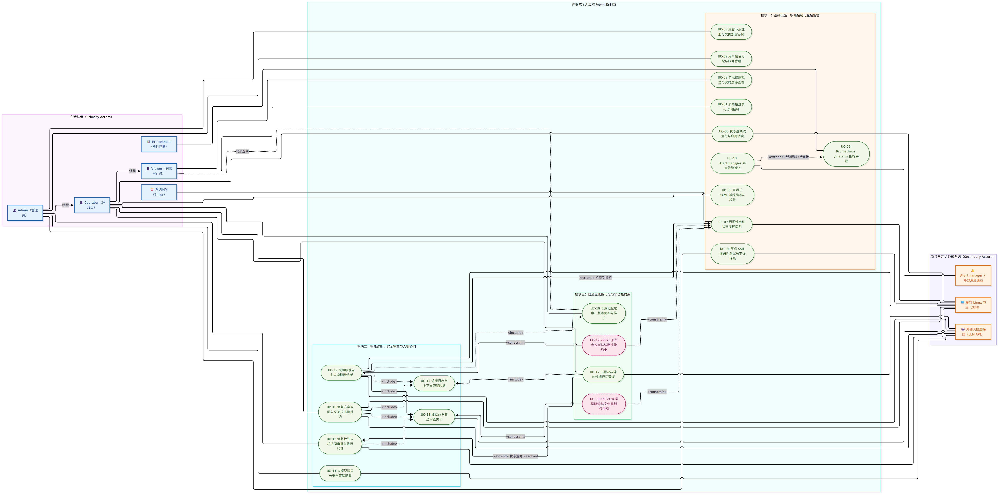

# 软件需求规约

**项目名称**：具备自适应长期记忆的声明式个人运维 Agent
**文档版本**：v1.0
**更新日期**：2026 年 11 月 27 日

| 学号    | 姓名   | 技术模块负责                 | 课程角色                        |
| :------ | :----- | :--------------------------- | :------------------------------ |
| 2450313 | 徐佳咏 | 状态协调引擎与漂移探测       | 组长 / 架构设计 / DevOps 负责人 |
| 2351428 | 徐之涵 | LLM 诊断智能体与长期记忆     | 开发 / AI 负责人                |
| 2352626 | 马小云 | Web 前端与后端控制面         | 开发 / 需求分析                 |
| 2452075 | 唐荣炜 | 运维安全审查、脱敏与监控集成 | 开发 / 测试负责人               |

**关联文档**：

- 项目章程与选型论证：[README.md](../README.md)
- 需求调研计划与报告：[research_plan.md](./research_plan.md)、[research_report.md](./research_report.md)
- 用户故事清单：[user_stories.md](./user_stories.md)
- 用例清单与用例图：[use_case.md](./use_case.md)

---

## 1. 引言

### 1.1 编写目的与文档约定

本文档为“具备自适应长期记忆的声明式个人运维 Agent”项目的软件需求规约（Software Requirements Specification，SRS），用于完整、准确、可验证地定义系统的业务目标、范围边界、角色权限、功能需求、核心场景与业务流程、非功能需求、约束条件以及需求追溯与变更机制。本文档作为后续分析建模、概要设计、详细设计、编码实现、系统测试及期末答辩验收的基线依据。

### 1.2 项目背景与业务目标

#### 1.2.1 现状痛点

在云原生与自托管普及的背景下，个人开发者、实验室服务器维护者及小型科研团队通常需要同时维护数台至数十台云主机、本地工作站及容器化服务。根据前期 [需求调研报告](./research_report.md) 的访谈与竞品分析，现有运维场景存在三大突出痛点：

1. 运维工具两极分化：企业级监控与自动化运维平台架构沉重、配置门槛高，不适合个人及小型团队规模；纯手动 SSH 排障则充斥大量重复性劳动，且缺乏过程留痕与协作可见性。
2. 运维经验随时间流失：维护者在数月后再次遇到相同的容器 OOM 退出、磁盘占满、SSL 证书续期失败或端口冲突问题时，往往遗忘历史排查命令与临时修复脚本，被迫重复定位。
3. 通用大模型直接运维风险高：将通用 LLM harness 直接用于服务器排障缺乏只读与变更隔离、命令安全审查、人工审批门禁及凭据脱敏机制，存在误删数据与泄露敏感密钥的严重隐患。

#### 1.2.2 核心解决方案与业务目标

本项目构建一个轻量级、无目标端代理的声明式 Agentic 运维控制面，将三项核心能力有机统一：

1. 无代理轻量级控制面与三角色协作：控制面打包为单一 Go 可执行文件（内嵌 SQLite 数据库与 Vue 3 静态前端），通过标准 SSH 连接管理多台 Linux 节点，无需在目标主机安装常驻代理；提供 `Admin / Operator / Viewer` 三角色权限模型，并暴露标准 Prometheus `/metrics` 端点接入 Alertmanager 实现异常推送。
2. 声明式智能体状态协调：运维人员通过简洁的 YAML 基线文件及自然语言运维意图声明期望状态（服务存活、容器健康、端口可达性、证书有效期及资源阈值等）。定时探测发现状态漂移后，诊断智能体在独立命令安全审查与密钥脱敏的约束下自动执行只读排查，形成结构化根因报告与修复计划，经管理员审批后执行并复检收敛。
3. 自适应长期记忆：故障解决后，系统将脱敏后的排障过程与已验证修复步骤蒸馏为结构化记忆条目存入 SQLite，并在后续同类漂移发生时通过关键词检索自动复用，随人工修订持续演进。

业务目标：

1. 效率目标：借助历史故障记忆检索与自主只读诊断，将常见重复运维故障的平均定位与修复耗时较纯手动 SSH 排障降低 60% 以上。
2. 安全目标：通过独立命令审查智能体、只读/变更隔离、人机协同审批与密钥脱敏中间件，实现未授权不可逆高危变更执行率为 0%、标准凭据模式脱敏覆盖率 100%。
3. 可用性目标：控制面以单一可执行文件分发，熟悉 Linux 与 SSH 的用户可在 10 分钟内完成部署、纳管 3 台及以上 Linux 节点并启用基线模板。

### 1.3 系统范围与边界

- 纳入范围：
    - 面向个人开发者、实验室服务器管理员及小型科研团队（中小规模 Linux 节点群，常规监控上限规划为 20 台节点）。
    - 纳管目标 Linux 节点的宿主资源（CPU/内存/磁盘）、`systemd` 服务、Docker 容器、端口/连通性与证书等常见运维对象。
    - 三角色访问控制（`Admin` / `Operator` / `Viewer`）、SSH 凭据加密存储、YAML 声明式基线管理、定时状态漂移探测、Prometheus `/metrics` 与 Alertmanager 告警集成。
    - 基于 OpenAI 兼容接口的 ReAct 只读根因诊断、独立命令安全审查智能体、本地密钥脱敏、人机协同审批（HITL）、交互式排障对话及自适应长期记忆库。
- 排除范围：
    - 不面向大型企业级多租户隔离或复杂组织层级 RBAC。
    - 不在目标 Linux 节点上部署侵入式常驻守护进程。
    - 不支持未经人工确认的全自动高危写操作执行，破坏性指令一律硬拦截，变更类指令强制人机审批。
    - 暂不纳管 Windows / macOS 作为受管目标节点，目标节点限定为 Linux。

### 1.4 术语

| 编号 | 术语                                                                 | 定义                                                                                                                                                                                         |
| :--- | :------------------------------------------------------------------- | :------------------------------------------------------------------------------------------------------------------------------------------------------------------------------------------- |
| 1    | **声明式状态基线（Declarative State Manifest）**                     | 由运维人员编写的结构化 YAML 文档（可附带自然语言运维意图注释），用于声明目标节点服务、容器或资源的期望终态，而非编写过程式操作脚本。                                                         |
| 2    | **状态漂移（State Drift）**                                          | 通过确定性 SSH 探测获取的目标 Linux 节点实际运行态，与已激活（`Active`）声明式状态基线之间出现的任何偏离。                                                                                   |
| 3    | **声明式智能体状态协调（Declarative Agentic State Reconciliation）** | 将确定性状态漂移探测与大语言模型驱动的根因推理、修复计划生成相结合的混合控制闭环，用于在安全约束下将漂移节点恢复至期望状态。                                                                 |
| 4    | **无代理控制面（Agentless Control Plane）**                          | 中央控制面守护进程仅通过标准 SSH 协议与受管主机通信，无需在目标主机上安装任何持久化运行代理程序。此处“无代理”指目标端无常驻二进制，而非否定控制面的 LLM 智能体。                             |
| 5    | **自适应长期记忆（Adaptive Long-Term Memory）**                      | 持久化在本地 SQLite 中的结构化历史故障经验库，支持按症状关键词检索、命中计数统计及随方案改进自动版本演进（`Active` / `Superseded`）。                                                        |
| 6    | **记忆蒸馏（Memory Distillation）**                                  | 故障状态流转为 `Resolved` 后，由大模型将冗长的多轮诊断轨迹与已验证修复步骤压缩、提炼为精简且已脱敏的结构化情景记忆条目的过程。                                                               |
| 7    | **人机协同审批门禁（Human-in-the-Loop, HITL）**                      | 强制性架构关卡：当智能体提出任何可能修改目标节点状态的修复命令时，立即挂起智能体执行流，交由具备审批权限的管理员审阅、微调参数、批准或驳回。                                                 |
| 8    | **独立命令审查智能体（Independent Command Review Agent）**           | 独立于诊断智能体的专用安全审查智能体，在任何候选 SSH 命令执行前将其划分为 `READ_ONLY`、`MUTATING` 或 `DESTRUCTIVE` 三个安全等级；遇混淆指令或审查服务不可用时默认采取 Fail-Closed 阻断策略。 |
| 9    | **密钥脱敏中间件（Secret Redaction Middleware）**                    | 位于本地控制面的数据净化管道，在 SSH 命令输出或上下文发往外部大模型接口及写入 SQLite 前，识别并将 API Key、Token、密码、私钥等敏感凭据统一替换为 `[REDACTED_SECRET]`。                       |
| 10   | **只读诊断探测（Read-Only Diagnostic Probe）**                       | 经验证不会改变目标主机文件系统、网络配置或进程状态的非破坏性检查命令（如 `df -h`、`free -m`、`ps`、`systemctl status`、`docker logs --tail`、`docker inspect`）。                            |
| 11   | **变更类修复操作（Mutating Remediation Action）**                    | 任何可能改变目标节点状态的 Shell 命令或生命周期操作（如重启容器/服务、清理或截断日志、修改配置文件、调整防火墙规则）。                                                                       |
| 12   | **Fail-Closed（故障安全闭合）**                                      | 安全容错原则：当命令语法被混淆、无法明确判定为只读，或独立命令审查智能体超时/不可用时，系统默认拒绝放行，禁止无人值守执行。                                                                  |
| 13   | **ReAct**                                                            | Reasoning and Acting 范式，将大模型的链式推理与外部工具调用及环境观测交替结合的智能体循环框架。                                                                                              |
| 14   | **Prometheus / Alertmanager**                                        | 云原生开源监控与告警生态组件：Prometheus 定时拉取控制面暴露的 `/metrics` 指标，满足告警规则后交由 Alertmanager 路由推送至 Webhook、IM 或邮件等外部消息渠道。                                 |

---

## 2. 干系人、角色权限与外部接口

### 2.1 内部用户角色与权限矩阵

系统面向个人及小团队/实验室协作场景，采用三级继承式轻量级权限控制模型：`Admin` 继承 `Operator`，`Operator` 继承 `Viewer`。未登录或越权请求一律返回 `HTTP 403` 并记录审计日志。

| 功能域 / 操作项                                          | Viewer（只读审计员） | Operator（运维员） | Admin（管理员） | 对应需求 / 用例     |
| :------------------------------------------------------- | :------------------: | :----------------: | :-------------: | :------------------ |
| 账号登录与身份鉴权                                       |         允许         |        允许        |      允许       | US-01 / UC-01       |
| 查看节点健康概览、漂移告警与诊断轨迹                     |         允许         |        允许        |      允许       | US-08 / UC-08       |
| 查阅历史长期记忆库                                       |         允许         |        允许        |      允许       | US-18 / UC-18       |
| 编写、校验、试运行与启用 YAML 状态基线                   |         禁止         |        允许        |      允许       | US-05~06 / UC-05~06 |
| 发起交互式排障对话、附约束驳回修复方案                   |         禁止         |        允许        |      允许       | US-16 / UC-16       |
| 确认/丢弃蒸馏记忆、编辑与归档长期记忆                    |         禁止         |        允许        |      允许       | US-17~18 / UC-17~18 |
| 创建/停用成员账号与分配角色                              |         禁止         |        禁止        |      允许       | US-02 / UC-02       |
| 注册受管 Linux 节点、管理 SSH 私钥、测试连通性与下线节点 |         禁止         |        禁止        |      允许       | US-03~04 / UC-03~04 |
| 配置 LLM 接口端点、API Key、推理轮数与脱敏规则           |         禁止         |        禁止        |      允许       | US-11 / UC-11       |
| 审批、微调参数并批准执行状态变更类修复计划               |         禁止         |        禁止        |      允许       | US-15 / UC-15       |

### 2.2 系统触发器与外部系统

| 参与者名称                        | 类型                   | 交互协议 / 接口         | 职责与交互说明                                                                                                                                         |
| :-------------------------------- | :--------------------- | :---------------------- | :----------------------------------------------------------------------------------------------------------------------------------------------------- |
| **系统时钟**                      | 主参与者（内部触发器） | 进程内定时器            | 按各 `Active` 基线配置的探测周期定时触发 `UC-07` 只读状态漂移探测。                                                                                    |
| **Prometheus**                    | 主参与者（外部拉取方） | `/metrics`              | 定时抓取控制面节点在线数、探测耗时、漂移次数及大模型调用耗时，并评估告警规则。                                                                         |
| **受管 Linux 节点（SSH Server）** | 次参与者（外部系统）   | SSH（密钥认证）         | 承载业务服务与容器；执行 SSH 连通性测试、确定性状态探测、只读诊断命令及经 `Admin` 审批的变更修复命令。                                                 |
| **OpenAI 兼容大模型接口**         | 次参与者（外部系统）   | OpenAI Chat Completions | 为诊断智能体（`UC-12`）、独立命令安全审查智能体（`UC-13`）、交互式排障对话（`UC-16`）与记忆蒸馏（`UC-17`）提供推理能力；支持云端与本地自托管兼容服务。 |
| **Alertmanager**                  | 次参与者（外部系统）   | Webhook / IM / 邮件     | 接收 Prometheus 触发的 `Firing` 告警，在 1 分钟内将漂移摘要与控制面处理链接推送至管理员。                                                              |

---

## 3. 业务流程与 Agent 交互模型

### 3.1 核心业务流程一：声明式状态协调与人机协同修复

该流程涵盖从定时状态漂移探测（`UC-07`）、外部监控告警（`UC-09 / UC-10`）、多轮只读 ReAct 诊断（`UC-12 / UC-13 / UC-14 / UC-18`）、人机协同审批与驳回重规划（`UC-15 / UC-16`）直至记忆蒸馏（`UC-17`）的端到端闭环：

1. 定时探测与告警：系统时钟按周期触发只读 SSH 探测（`UC-07`）；未发生漂移则维持 Healthy 并刷新 `/metrics`（`UC-09`）；检测到状态漂移则创建 Open 故障事件、刷新指标并经由 Prometheus / Alertmanager 推送外部告警（`UC-10`）。
2. 降级分支：若外部大模型接口不可用（`UC-20`），基础探测与告警持续运行，事件置为 Escalated 待人工排查修复并在解决后转入记忆蒸馏。
3. 自主只读诊断循环：外部大模型可用时，系统先调用 `search_memory()` 检索历史同类记忆（`UC-18`），组装脱敏上下文后由诊断智能体循环调用 `exec_readonly_shell()`（`UC-12`）；每条命令须经独立命令审查智能体评估（`UC-13`），仅 `READ_ONLY` 放行并经密钥脱敏中间件净化回传（`UC-14`），非只读或异常命令均拦截。若超过 `max_turns` 仍未收敛，则置为 Escalated 交人工介入。
4. 人机协同审批与复检收敛：根因定位后，智能体调用 `propose_remediation_plan()` 提交修复方案（经 `UC-13` 拦截任何 `DESTRUCTIVE` 指令），循环挂起并将事件置为 Pending Approval（`UC-15`）。`Operator` 或 `Admin` 可附约束驳回触发重规划（`UC-16`）；`Admin` 批准或微调参数（二次安全审查）后通过 SSH 执行修复，并自动重跑基线探测验证收敛；期望状态恢复后置为 Resolved 并进入记忆蒸馏流程（`UC-17`）。

### 3.2 核心业务流程二：自适应长期记忆蒸馏、三分支更新与维护

1. 蒸馏与脱敏：故障事件流转为 Resolved 后，系统汇总漂移症状、关键诊断观测、人工微调及已验证修复步骤（`UC-17`），经密钥脱敏中间件清除残留敏感凭据（`UC-14`），由大模型调用 `commit_memory_record()` 生成结构化记忆草案。
2. SQLite 三分支更新：未命中既有记忆（`matched_memory_id` 为空）则插入新记录（Active）并建立关键词索引；命中既有记忆且修复方案未修改（`is_modified = false`）则递增 `hit_count` 并更新 `last_verified_at`；命中既有记忆且经人工修改（`is_modified = true`）则插入新版本（Active）并将旧记录标记为 Superseded。
3. 人工审阅与维护：Web 控制台向 `Operator` 展示蒸馏记忆卡片，支持丢弃一次性偶发异常（移出活跃记忆池，原始日志保留归档）或确认保留以供后续 `search_memory()` 检索与日常维护（`UC-18`）。

### 3.3 Agent 输入上下文、工具行动空间与人机交接机制

为保证大模型行为可控、可审计且满足“规格先行、人守关卡、护密合规”原则，系统严格限定智能体的上下文输入源（声明式 YAML 基线与运维意图、漂移遥测与脱敏 SSH 日志、SQLite 关键词匹配的历史记忆）、工具行动空间（本地记忆工具、只读 SSH 工具与变更方案工具）以及独立命令审查与强制人工审批交接边界。

**核心工具契约表**：

| 工具名称                   | 输入参数                                                                                                                                                                     | 行动范围                                                                                                                                                                     | 执行模式与人工交接边界                                                                                                                                                                               |
| :------------------------- | :--------------------------------------------------------------------------------------------------------------------------------------------------------------------------- | :--------------------------------------------------------------------------------------------------------------------------------------------------------------------------- | :--------------------------------------------------------------------------------------------------------------------------------------------------------------------------------------------------- |
| `search_memory`            | `keywords: string[]` `count: int = 3`                                                                                                                                    | 通过关键词查询本地 SQLite 长期记忆库，检索历史同类故障根因与已验证修复方案（`UC-12`、`UC-16`、`UC-18`）。                                                                    | 无人值守自动执行：本地只读 SQLite 查询；通过 `count` 限制返回条数以防上下文窗口溢出。                                                                                                                |
| `exec_readonly_shell`      | `node_id: string` `command: string`                                                                                                                                      | 在目标 Linux 节点通过 SSH 执行只读诊断探针（如 `df -h`、`free -m`、`ps`、`systemctl status`、`journalctl -n`、`docker logs --tail`、`docker inspect`）（`UC-12`、`UC-16`）。 | 审查通过后自动执行：执行前必经独立命令审查智能体（`UC-13`）评估，仅 `READ_ONLY` 放行，输出经脱敏中间件（`UC-14`）净化并截断后回传；`MUTATING`、`DESTRUCTIVE` 或 Fail-Closed 立即拦截。               |
| `propose_remediation_plan` | `node_id: string` `root_cause: string` `actions: { description, command, risk_level }[]`                                                                             | 结束本轮诊断，提交结构化根因总结及有序的变更类修复指令列表（`UC-12` → `UC-15`）。                                                                                            | 强制人机协同交接（HITL）：计划中任何 `DESTRUCTIVE` 命令均被 `UC-13` 硬拦截；`MUTATING` 操作挂起智能体循环，等待 `Admin` 在 Web 控制台审批执行，或由 `Operator / Admin` 附约束驳回重规划（`UC-16`）。 |
| `commit_memory_record`     | `symptom_keywords: string[]` `root_cause: string` `remediation_steps: string[]` `scope_tags: string[]` `matched_memory_id?: string` `is_modified?: bool` | 故障解决（`Resolved`）后，将脱敏后的排障与修复经验持久化或更新至 SQLite 记忆库（`UC-17`）。                                                                                  | 自动蒸馏 + 人工审阅确认：写入前经 `UC-14` 再次脱敏，按 SQLite 三分支规则落库（新增 / 递增 `hit_count` / 标记旧版 `Superseded`）；`Operator` 可在 Web 界面审阅保留或丢弃偶发异常。                    |

---

## 4. 功能需求与用例规约

### 4.1 系统用例总览

系统共定义 20 个用例（`UC-01` ~ `UC-20`），涵盖基础设施与监控告警、智能诊断与安全审批、自适应长期记忆及非功能保障三大模块。详细分模块用例图见 [use_case.md](./use_case.md)。

### 4.2 完整功能需求清单（`US-01` ~ `US-18`）

#### 4.2.1 模块一：基础设施、权限控制与监控告警

| 需求 ID / 用例编号 | 名称                                | 主/次参与者                                               | 功能描述                                                                                                                                                                           | 验收标准（Given / When / Then）                                                                                                                                                                                |
| :----------------- | :---------------------------------- | :-------------------------------------------------------- | :--------------------------------------------------------------------------------------------------------------------------------------------------------------------------------- | :------------------------------------------------------------------------------------------------------------------------------------------------------------------------------------------------------------- |
| **US-01 / UC-01**  | 多角色登录与访问控制                | 主：Viewer（Operator、Admin 继承） 次：—              | 用户使用独立账号登录控制面，后端按 `Admin / Operator / Viewer` 角色校验所有接口权限，拦截越权访问并写入审计日志。                                                                  | **Given** 用户未登录或以 `Viewer` 身份登录系统； **When** 尝试调用节点修改、基线编辑或命令审批接口； **Then** 系统返回 `HTTP 403` 拒绝访问并记录越权审计日志。                                         |
| **US-02 / UC-02**  | 用户角色分配与账号管理              | 主：Admin 次：—                                       | 支持管理员创建、停用团队成员账号并分配或调整其角色，规范小团队与实验室协作分工。                                                                                                   | **Given** `Admin` 已登录账号管理页面； **When** 新增成员并分配为 `Operator` 角色后保存； **Then** 新成员仅可执行基线维护与诊断查询，无法访问 LLM API 密钥配置页面。                                    |
| **US-03 / UC-03**  | 受管 Linux 节点注册与凭据加密存储   | 主：Admin 次：—                                       | 支持管理员录入目标 Linux 节点主机地址、端口、用户名与 SSH 私钥（及可选口令），使用基于主机主密钥派生的加密密钥加密后存入 SQLite，实现无代理纳管。                                  | **Given** `Admin` 在节点管理表单填写有效的 SSH 连接参数与私钥； **When** 提交保存节点信息； **Then** 系统使用主密钥加密私钥并存入 SQLite，数据库文件中不出现明文私钥。                                 |
| **US-04 / UC-04**  | 节点 SSH 连通性测试与下线移除       | 主：Admin 次：受管 Linux 节点                         | 支持一键验证控制面至目标节点的 SSH 连通性与认证有效性，并支持移除已下线主机资产。                                                                                                  | **Given** 控制面已存在一个注册节点； **When** `Admin` 点击连通性测试按钮； **Then** 系统在 5 秒内完成 SSH 握手并返回节点主机名与系统版本，或返回明确超时/认证失败原因。                                |
| **US-05 / UC-05**  | 声明式期望状态 YAML 基线编写与校验  | 主：Operator（Admin 继承） 次：—                      | 支持通过可视化表单或 YAML 编辑器定义节点期望状态（systemd 服务存活、Docker 容器状态、端口可达性、证书有效期、磁盘/内存阈值）及自然语言运维意图，保存前自动执行语法与 Schema 校验。 | **Given** `Operator` 编写了一份包含语法错误或缺失必填字段的 YAML 基线； **When** 点击保存或校验按钮； **Then** 系统阻断保存并在界面高亮提示具体错误行与字段说明。                                      |
| **US-06 / UC-06**  | 状态基线试运行与启用调度            | 主：Operator（Admin 继承） 次：受管 Linux 节点        | 支持对草稿状态（`Draft`）基线执行即时只读试运行探测，比对期望值与实际值差异，确认无误后激活为 `Active` 并加入定时调度。                                                            | **Given** 一份语法校验通过的 `Draft` 状态基线； **When** `Operator` 点击试运行并确认激活； **Then** 系统立即执行一次比对并展示期望值与实际值差异，激活后基线状态变为 `Active` 并加入定时调度。         |
| **US-07 / UC-07**  | 周期性自动状态漂移探测              | 主：系统时钟 次：受管 Linux 节点                      | 内部调度器按各 `Active` 基线配置的周期自动执行轻量级确定性只读 SSH 探测；发现实际状态偏离期望状态时生成 `Open` 故障事件并触发后续诊断。                                            | **Given** 节点配置了 60 秒探测周期的 `Active` 基线，且目标容器意外停止； **When** 调度周期到达并完成 SSH 探测； **Then** 系统在 2 秒内完成单节点探测、判定状态漂移并生成一条状态为 `Open` 的故障事件。 |
| **US-08 / UC-08**  | 节点健康概览与实时漂移状态查看      | 主：Viewer（Operator、Admin 继承） 次：—              | 在 Web 控制台首页展示受管节点总数、健康节点数、资源摘要及实时漂移事件列表，并根据当前登录角色控制写操作入口的可见性。                                                              | **Given** `Viewer` 登录 Web 控制台； **When** 进入节点健康概览页； **Then** 页面展示受管节点总数、健康节点数、漂移事件列表，且所有修改与审批操作按钮处于隐藏或禁用状态。                               |
| **US-09 / UC-09**  | Prometheus `/metrics` 指标接口暴露  | 主：Prometheus 次：—                                  | 控制面暴露标准 `/metrics` HTTP 端点，输出节点在线状态、单节点探测耗时、累计状态漂移次数、待审批事件数及大模型调用耗时等监控指标。                                                  | **Given** 控制面处于运行状态； **When** Prometheus 定时抓取控制面的 `/metrics` 端点； **Then** 端点返回 `HTTP 200` 及符合 OpenMetrics / Prometheus 文本格式的节点健康与漂移指标。                      |
| **US-10 / UC-10**  | Alertmanager 异常告警与外部消息推送 | 主：Prometheus 次：Alertmanager / 外部消息通道、Admin | 当持续状态漂移或待审批事件触发 Prometheus 告警规则并进入 `Firing` 状态时，通过 Alertmanager 路由推送至 Webhook、飞书、钉钉或邮件等外部消息渠道。                                   | **Given** 节点发生持续状态漂移且触发 Prometheus 告警规则； **When** 告警状态进入 `Firing` 并送达 Alertmanager； **Then** 外部消息接收端在 1 分钟内收到包含节点名、漂移摘要与控制面处理链接的推送消息。 |

#### 4.2.2 模块二：智能诊断、安全审查与人机协同

| 需求 ID / 用例编号 | 名称                           | 主/次参与者                                                            | 功能描述                                                                                                                                                                                                                        | 验收标准（Given / When / Then）                                                                                                                                                                                                   |
| :----------------- | :----------------------------- | :--------------------------------------------------------------------- | :------------------------------------------------------------------------------------------------------------------------------------------------------------------------------------------------------------------------------ | :-------------------------------------------------------------------------------------------------------------------------------------------------------------------------------------------------------------------------------- |
| **US-11 / UC-11**  | 大模型接口与自主性安全策略配置 | 主：Admin 次：外部大模型接口                                       | 支持管理员配置 OpenAI 兼容接口地址、API Key、诊断模型与安全审查模型名称、最大推理轮数 `max_turns`（默认 8）、SSH 超时及自定义脱敏规则。                                                                                         | **Given** `Admin` 填写新的兼容模型端点与最大推理轮数（如 `max_turns = 8`）并保存； **When** 系统后续触发诊断推理； **Then** 请求路由至新配置的模型接口，且 API Key 在数据库中加密存储。                                   |
| **US-12 / UC-12**  | 故障触发自主只读根因诊断       | 主：漂移事件触发（源自 UC-07） 次：外部大模型接口、受管 Linux 节点 | 漂移事件创建后，诊断智能体先检索长期记忆库，再在 `max_turns` 轮数上限内循环执行经审查放行的只读诊断命令，最终输出根因报告与修复计划并置事件为 `Pending Approval`；超轮数未收敛则置为 `Escalated`。                              | **Given** 系统生成一条状态漂移事件； **When** 启动 ReAct 诊断循环； **Then** 智能体在不超过 `max_turns` 轮内完成只读排查，产出结构化根因报告与修复计划，并将事件状态置为 `Pending Approval`；若超轮数则置为 `Escalated`。 |
| **US-13 / UC-13**  | 独立命令安全审查关卡           | 主：—（被 UC-12 / UC-15 / UC-16 包含） 次：外部大模型接口          | 在任何候选 SSH 命令执行前，由独立命令审查智能体将其分类为 `READ_ONLY`、`MUTATING` 或 `DESTRUCTIVE`。诊断阶段仅放行 `READ_ONLY`；混淆命令或审查服务异常时采用 Fail-Closed 策略拒绝放行；破坏性指令在所有场景下硬拦截并告警。     | **Given** 诊断智能体尝试在诊断阶段调用包含 `rm`、`systemctl restart` 或混淆编码的指令； **When** 命令经过独立命令安全审查关卡； **Then** 审查关卡将其判定为非只读并立即拦截执行，同时向智能体返回禁止修改的提示。         |
| **US-14 / UC-14**  | 诊断日志与回传上下文密钥脱敏   | 主：—（被 UC-12 / UC-16 / UC-17 包含） 次：—                       | 在远程 SSH 输出、上下文提示词发送至外部大模型接口或存入 SQLite 前，本地脱敏中间件自动识别并掩码 API Key、Bearer Token、密码字段及私钥文本。                                                                                     | **Given** 远程节点返回的日志文本中包含标准格式的 API Key、Bearer Token 或密码字段； **When** 日志经过脱敏中间件处理； **Then** 所有匹配凭据均被替换为 `[REDACTED_SECRET]`，且明文凭据不出现在外发请求与数据库记录中。     |
| **US-15 / UC-15**  | 修复计划人机协同审批与执行验证 | 主：Admin 次：受管 Linux 节点                                      | 在审批界面呈现漂移告警、命中记忆、脱敏诊断轨迹、根因结论及带风险等级的修复命令列表；支持 `Admin` 确认或微调参数（再次经 `UC-13` 拦截破坏性操作）后批准执行，执行后自动重跑基线探测验证收敛，通过后置事件为 `Resolved`。         | **Given** 故障事件处于 `Pending Approval` 状态； **When** `Admin` 点击批准执行按钮； **Then** 系统通过 SSH 执行已批准命令，并自动重跑一次声明式状态探测；探测通过后事件状态流转为 `Resolved`。                            |
| **US-16 / UC-16**  | 修复方案驳回与交互式排障对话   | 主：Operator（Admin 继承） 次：外部大模型接口、受管 Linux 节点     | 提供自然语言运维对话窗口支持查询集群状态与协同排障，并允许运维员对不合理的待审批修复方案附带约束反馈点击驳回，驱动智能体重新规划；对话中的只读查询同样受 `UC-13` 安全审查与 `UC-14` 脱敏约束，任何写操作必须转入 `UC-15` 审批。 | **Given** `Operator` 对当前修复方案不满意并输入约束反馈后点击驳回； **When** 智能体接收到反馈并重新规划； **Then** 智能体基于新的约束条件生成修订后的修复方案并重新提交审批；对话中的只读查询同样受安全审查约束。         |

#### 4.2.3 模块三：自适应长期记忆

| 需求 ID / 用例编号 | 名称                             | 主/次参与者                                                     | 功能描述                                                                                                                                                                                                           | 验收标准（Given / When / Then）                                                                                                                                                                                           |
| :----------------- | :------------------------------- | :-------------------------------------------------------------- | :----------------------------------------------------------------------------------------------------------------------------------------------------------------------------------------------------------------- | :------------------------------------------------------------------------------------------------------------------------------------------------------------------------------------------------------------------------ |
| **US-17 / UC-17**  | 已解决故障的自适应长期记忆蒸馏   | 主：Operator、故障解决事件（源自 UC-15） 次：外部大模型接口 | 故障流转为 `Resolved`（审批执行成功或人工解决）后，系统对完整排障轨迹二次脱敏并调用大模型提炼为结构化记忆卡片（症状关键词、根因、修复步骤、适用范围标签），展示给 `Operator` 确认保留或丢弃。                      | **Given** 一个故障事件通过审批执行或人工修复并标记为 `Resolved`； **When** 触发记忆蒸馏流程； **Then** 系统生成包含症状关键词、根因、修复步骤与适用范围标签的结构化记忆卡片，并展示给 `Operator` 确认保留或丢弃。 |
| **US-18 / UC-18**  | 长期记忆检索、版本更新与日常维护 | 主：Operator（维护）、Viewer（只读） 次：—                  | 支持按关键词检索历史运维记忆，支持 `Operator` 编辑修复模板与归档过时条目；自动执行三分支版本更新（新增 / 命中计数 `hit_count` 递增 / 方案修改后写入新版本并将旧版标记为 `Superseded`）；对 `Viewer` 开放只读检索。 | **Given** 记忆库中已存在历史同类故障记录； **When** 新故障命中旧记忆且修复步骤经人工修改后验证有效； **Then** 系统插入新版本记忆并将旧记录标记为 `Superseded`；若未修改则递增原记录命中计数 `hit_count`。         |

---

### 4.3 细化用例规约

以下选取 5 组高复杂度用例编写详细场景规约。

#### 4.3.1 `UC-05 / UC-06`：声明式期望状态 YAML 基线编写、试运行与启用调度

| 字段                     | 规约详情                                                                                                                                                                                                                                                                                                                                                                                                                                                                   |
| :----------------------- | :------------------------------------------------------------------------------------------------------------------------------------------------------------------------------------------------------------------------------------------------------------------------------------------------------------------------------------------------------------------------------------------------------------------------------------------------------------------------- |
| **用例编号与名称**       | `UC-05 / UC-06`：声明式期望状态 YAML 基线编写、校验、试运行与启用调度                                                                                                                                                                                                                                                                                                                                                                                                      |
| **关联需求**             | `US-05`、`US-06`                                                                                                                                                                                                                                                                                                                                                                                                                                                           |
| **参与者**               | 主参与者：`Operator`（`Admin` 继承） · 次参与者：`受管 Linux 节点`                                                                                                                                                                                                                                                                                                                                                                                                         |
| **前置条件**             | 用户已以 `Operator` 或 `Admin` 身份登录 Web 控制台（`UC-01`），且至少已注册一台受管 Linux 节点（`UC-03`）。                                                                                                                                                                                                                                                                                                                                                                |
| **后置条件**             | • 成功：校验通过的 YAML 基线以 `Active` 状态存入 SQLite，并注册至内部定时调度器周期执行（`UC-07`）。 • 草稿 / 失败（2a、3a）：校验失败时阻断保存；节点不可达时以 `Draft` 状态保存且不加入定时调度。                                                                                                                                                                                                                                                                    |
| **触发事件**             | 运维员在 Web 控制台创建或编辑目标节点的声明式期望状态策略。                                                                                                                                                                                                                                                                                                                                                                                                                |
| **主成功场景**           | 1. 运维员选择目标节点，通过表单或 YAML 编辑器定义期望状态规则（如 systemd 服务状态、Docker 容器运行态、端口连通性、证书有效期、磁盘/内存阈值）及自然语言运维意图注释。 2. 系统执行 YAML 语法解析与 Schema 字段校验，确认无缺失或非法字段。 3. 运维员点击“试运行”，系统立即通过只读 SSH 探测目标节点当前运行态，并在界面并排展示“期望值 vs 实际值”差异。 4. 运维员确认配置无误并点击“激活启用”，系统将基线状态置为 `Active` 并加入定时探测调度队列（`UC-07`）。 |
| **扩展（备选与异常流）** | • 2a. 语法或 Schema 校验失败：系统阻断保存与激活，在编辑器中高亮报错行号及字段说明。 • 3a. 目标节点 SSH 不可达或超时：系统在界面提示连接超时或认证失败原因，仅允许以 `Draft` 状态保存，不进入定时调度。                                                                                                                                                                                                                                                                |

#### 4.3.2 `UC-12`：故障触发自主只读根因诊断

| 字段                     | 规约详情                                                                                                                                                                                                                                                                                                                                                                                                                                                                                                                                                                                                                                                                                                                                                                                                                                    |
| :----------------------- | :------------------------------------------------------------------------------------------------------------------------------------------------------------------------------------------------------------------------------------------------------------------------------------------------------------------------------------------------------------------------------------------------------------------------------------------------------------------------------------------------------------------------------------------------------------------------------------------------------------------------------------------------------------------------------------------------------------------------------------------------------------------------------------------------------------------------------------------ |
| **用例编号与名称**       | `UC-12`：故障触发自主只读根因诊断                                                                                                                                                                                                                                                                                                                                                                                                                                                                                                                                                                                                                                                                                                                                                                                                           |
| **关联需求**             | `US-12`（包含 `UC-13`、`UC-14`、`UC-18`）                                                                                                                                                                                                                                                                                                                                                                                                                                                                                                                                                                                                                                                                                                                                                                                                   |
| **参与者**               | 触发方：系统（源自 `UC-07` 漂移事件） · 次参与者：`外部大模型接口`、`受管 Linux 节点`                                                                                                                                                                                                                                                                                                                                                                                                                                                                                                                                                                                                                                                                                                                                                       |
| **前置条件**             | `UC-07` 检测到 `Active` 基线发生状态漂移并生成 `Open` 故障事件；`Admin` 已完成外部大模型接口配置（`UC-11`）。                                                                                                                                                                                                                                                                                                                                                                                                                                                                                                                                                                                                                                                                                                                               |
| **后置条件**             | • 成功：故障事件状态流转为 `Pending Approval`，附带完整脱敏诊断轨迹、根因报告及待审批修复计划，转入 `UC-15`。 • 升级 / 降级（1a、6a）：事件状态置为 `Escalated`，保留已采集的脱敏诊断日志并通知人工介入，不排队任何修复计划。                                                                                                                                                                                                                                                                                                                                                                                                                                                                                                                                                                                                           |
| **触发事件**             | `UC-07` 发出状态漂移事件（例如目标容器异常退出或磁盘占用率超过 85%）。                                                                                                                                                                                                                                                                                                                                                                                                                                                                                                                                                                                                                                                                                                                                                                      |
| **主成功场景**           | 1. 系统打开诊断会话，提取漂移症状关键词并调用 `search_memory` 检索本地 SQLite 长期记忆库中的历史同类修复记录（`UC-18`）。 2. 系统组装初始诊断上下文（声明式 YAML 基线、漂移告警详情、命中的历史记忆记录）。 3. 诊断智能体提出根因假设，调用 `exec_readonly_shell` 发起只读检查命令（如 `df -h`、`journalctl -n 50`、`docker logs --tail 50`）。 4. 独立命令安全审查关卡（`UC-13`）对候选命令进行分级验证，确认为 `READ_ONLY` 后予以放行。 5. 控制面通过 SSH 执行只读命令，捕获输出并按最大长度截断，经密钥脱敏中间件（`UC-14`）掩码后追加至推理上下文。 6. 系统在配置的 `max_turns`（默认 8 轮）上限内重复步骤 3–5，直至定位明确根因。 7. 诊断智能体调用 `propose_remediation_plan` 提交结构化根因总结与有序修复命令列表（其中破坏性命令由 `UC-13` 预拦截），将故障事件状态置为 `Pending Approval` 并转入 `UC-15`。 |
| **扩展（备选与异常流）** | • 1a. 外部大模型接口不可用或超时（降级分支）：系统记录接口异常日志，将事件状态置为 `Escalated` 并由 Alertmanager 持续保障告警触达（`UC-20`），不影响后续周期探测。 • 4a. 诊断阶段尝试调用非只读命令：`UC-13` 立即拦截执行（包括 `MUTATING`、`DESTRUCTIVE` 或 Fail-Closed），向智能体返回禁止在诊断阶段修改系统状态的提示，引导其将修复动作写入最终 `propose_remediation_plan`。 • 6a. 达到 `max_turns` 轮数上限仍未收敛：系统终止推理循环，将事件状态置为 `Escalated`，保留脱敏日志并通知运维/管理员人工介入。                                                                                                                                                                                                                                                                                                                      |

#### 4.3.3 `UC-13 / UC-14`：独立命令安全审查关卡与诊断日志密钥脱敏

| 字段                     | 规约详情                                                                                                                                                                                                                                                                                                                                                                                                                                                                                                                                                                                                                                                                                                                                                                                                                                                        |
| :----------------------- | :-------------------------------------------------------------------------------------------------------------------------------------------------------------------------------------------------------------------------------------------------------------------------------------------------------------------------------------------------------------------------------------------------------------------------------------------------------------------------------------------------------------------------------------------------------------------------------------------------------------------------------------------------------------------------------------------------------------------------------------------------------------------------------------------------------------------------------------------------------------- |
| **用例编号与名称**       | `UC-13 / UC-14`：独立命令安全审查关卡与诊断日志密钥脱敏                                                                                                                                                                                                                                                                                                                                                                                                                                                                                                                                                                                                                                                                                                                                                                                                         |
| **关联需求**             | `US-13`、`US-14`（被 `UC-12`、`UC-15`、`UC-16`、`UC-17` 包含）                                                                                                                                                                                                                                                                                                                                                                                                                                                                                                                                                                                                                                                                                                                                                                                                  |
| **参与者**               | 触发方：系统内部同步拦截器 · 次参与者：`外部大模型接口`（用于独立命令审查智能体）                                                                                                                                                                                                                                                                                                                                                                                                                                                                                                                                                                                                                                                                                                                                                                               |
| **前置条件**             | 智能体或微调审批表单产生候选 SSH 命令（Part A），或控制面从远程 SSH 捕获原始命令输出及对话轨迹（Part B）。                                                                                                                                                                                                                                                                                                                                                                                                                                                                                                                                                                                                                                                                                                                                                      |
| **后置条件**             | 候选命令获得明确安全策略分级（`READ_ONLY` / `MUTATING` / `DESTRUCTIVE`）并按策略放行或拦截；所有外发至外部 LLM 接口及写入 SQLite 的文本均完成敏感凭据掩码。                                                                                                                                                                                                                                                                                                                                                                                                                                                                                                                                                                                                                                                                                                     |
| **触发事件**             | 每次 SSH 命令执行前的同步拦截（Part A）以及 SSH 输出捕获、记忆入库前的同步净化（Part B）。                                                                                                                                                                                                                                                                                                                                                                                                                                                                                                                                                                                                                                                                                                                                                                      |
| **主成功场景**           | Part A — 执行前独立命令安全审查（`UC-13`）： 1. 独立命令审查智能体（与诊断智能体上下文隔离）接收待执行命令与目标上下文，将其划分为三档安全等级： &nbsp;&nbsp;• `READ_ONLY`（如 `df`、`free`、`ps`、`systemctl status`、`docker logs --tail`）：允许在诊断与对话阶段无人值守自动执行； &nbsp;&nbsp;• `MUTATING`（如 `systemctl restart`、`truncate`、`rm`、配置文件修改）：诊断阶段直接拦截，仅允许作为修复计划提交至 `UC-15` 由 `Admin` 人工审批； &nbsp;&nbsp;• `DESTRUCTIVE`（如 `rm -rf /`、`mkfs`、`dd` 写块设备、停用 `sshd` 等）：全场景无条件硬拦截，写入高危安全审计日志并在 Web 控制台发出告警。 Part B — 执行后日志与上下文密钥脱敏（`UC-14`）： 2. 本地密钥脱敏中间件在原始 SSH 输出、诊断记录发送给外部 LLM API 或持久化至 SQLite 之前，匹配并替换所有 API Key、Bearer Token、密码字段及 PEM 私钥块为 `[REDACTED_SECRET]`。 |
| **扩展（备选与异常流）** | • 1a. 模糊、混淆指令或审查智能体不可用（Fail-Closed）：若命令包含混淆构造（如 `eval`、`base64 -d \| sh`、多层变量拼接）导致无法确定为 `READ_ONLY`，或外部审查智能体超时/返回 503，系统严格执行 Fail-Closed：一律按 `MUTATING` 拦截无人值守执行（涉及根目录/块设备或静态高危模式直接按 `DESTRUCTIVE` 硬拦截），确保 0% 漏放。                                                                                                                                                                                                                                                                                                                                                                                                                                                                                                                                    |

#### 4.3.4 `UC-15 / UC-16`：修复计划人机协同审批、驳回重规划与交互式排障

| 字段                     | 规约详情                                                                                                                                                                                                                                                                                                                                                                                                                                                                                                                                                                                                                                                                                                            |
| :----------------------- | :------------------------------------------------------------------------------------------------------------------------------------------------------------------------------------------------------------------------------------------------------------------------------------------------------------------------------------------------------------------------------------------------------------------------------------------------------------------------------------------------------------------------------------------------------------------------------------------------------------------------------------------------------------------------------------------------------------------ |
| **用例编号与名称**       | `UC-15 / UC-16`：修复计划人机协同审批、驳回重规划与交互式排障                                                                                                                                                                                                                                                                                                                                                                                                                                                                                                                                                                                                                                                       |
| **关联需求**             | `US-15`、`US-16`（包含 `UC-13`、`UC-14`、`UC-07`）                                                                                                                                                                                                                                                                                                                                                                                                                                                                                                                                                                                                                                                                  |
| **参与者**               | 主参与者：`Admin`（审批执行）、`Operator`（驳回重规划与交互式排障，Admin 继承） · 次参与者：`受管 Linux 节点`、`外部大模型接口`                                                                                                                                                                                                                                                                                                                                                                                                                                                                                                                                                                                     |
| **前置条件**             | 故障事件处于 `Pending Approval` 状态（来自 `UC-12` 或交互式对话 `UC-16`）；操作用户已完成身份与角色鉴权（`UC-01`）。                                                                                                                                                                                                                                                                                                                                                                                                                                                                                                                                                                                                |
| **后置条件**             | • 审批成功：已批准命令在目标节点执行完毕，状态基线复检通过，事件置为 `Resolved` 并触发 `UC-17` 记忆蒸馏。 • 驳回或复检未通过（2b、4a）：事件保持打开，触发智能体按约束重规划或转入下一轮排障，不触发 `UC-17`。                                                                                                                                                                                                                                                                                                                                                                                                                                                                                                  |
| **触发事件**             | 管理员打开待审批故障详情页，或运维员在 Web 控制台发起交互式排障对话 / 驳回当前修复计划。                                                                                                                                                                                                                                                                                                                                                                                                                                                                                                                                                                                                                            |
| **主成功场景**           | 1. Web 控制台展示漂移告警、命中历史记忆、脱敏后的只读诊断轨迹、根因结论以及拟执行修复命令（附带风险等级）。 2. `Admin` 核对诊断证据与命令参数，点击“批准并执行”。 3. 控制面通过 SSH 按序在目标节点执行已批准命令，并实时刷新执行回显与状态。 4. 命令执行完毕后，控制面自动重跑一次对应的声明式状态基线探测（`UC-07`）以验证期望状态是否收敛。 5. 探测通过后，系统将故障事件流转为 `Resolved`，自动触发自适应长期记忆蒸馏（`UC-17`）。                                                                                                                                                                                                                                                               |
| **扩展（备选与异常流）** | • 2a. Admin 微调命令参数后批准：`Admin` 修改参数后，修改后的命令须再次通过 `UC-13` 校验（阻断任何 `DESTRUCTIVE` 操作），且参数修改记录将被标记（`is_modified = true`）传入 `UC-17` 促进记忆演进。 • 2b. Operator / Admin 附约束驳回重规划（`UC-16`）：填写约束条件（如“禁止重启数据库，仅清理缓存日志”）并点击驳回；诊断智能体接收约束后重新规划并提交修订方案，重新进入 `Pending Approval`。 • 2c. Operator 发起交互式排障对话（`UC-16`）：运维员在对话窗口以自然语言追问节点异常，智能体可自动执行经 `UC-13` 放行与 `UC-14` 脱敏的只读查询；若需执行写操作，必须生成修复计划并转入本用例审批门禁。 • 4a. 复检仍存在状态漂移：系统保持事件处于打开状态，展示复检差异，提示发起新一轮诊断或转人工修复。 |

#### 4.3.5 `UC-17 / UC-18`：已解决故障的自适应长期记忆蒸馏与版本演进

| 字段                     | 规约详情                                                                                                                                                                                                                                                                                                                                                                                                                                                                                                                                                                                                                                                                                                                                                                                                                                                                                                                 |
| :----------------------- | :----------------------------------------------------------------------------------------------------------------------------------------------------------------------------------------------------------------------------------------------------------------------------------------------------------------------------------------------------------------------------------------------------------------------------------------------------------------------------------------------------------------------------------------------------------------------------------------------------------------------------------------------------------------------------------------------------------------------------------------------------------------------------------------------------------------------------------------------------------------------------------------------------------------------- |
| **用例编号与名称**       | `UC-17 / UC-18`：已解决故障的自适应长期记忆蒸馏、检索与日常维护                                                                                                                                                                                                                                                                                                                                                                                                                                                                                                                                                                                                                                                                                                                                                                                                                                                          |
| **关联需求**             | `US-17`、`US-18`（包含 `UC-14`）                                                                                                                                                                                                                                                                                                                                                                                                                                                                                                                                                                                                                                                                                                                                                                                                                                                                                         |
| **参与者**               | 主参与者：`Operator`（维护与确认，Admin 继承）、`Viewer`（只读查阅）、系统故障解决事件（源自 `UC-15`） · 次参与者：`外部大模型接口`                                                                                                                                                                                                                                                                                                                                                                                                                                                                                                                                                                                                                                                                                                                                                                                      |
| **前置条件**             | 故障事件状态流转为 `Resolved`（经 `UC-15` 验证收敛，或由人工解决 `Escalated` 事件后手动标记）。                                                                                                                                                                                                                                                                                                                                                                                                                                                                                                                                                                                                                                                                                                                                                                                                                          |
| **后置条件**             | • 确认保留：已脱敏的结构化记忆记录以 `Active` 状态写入或更新至 SQLite（被替代旧版本标记为 `Superseded`），可供后续检索。 • 丢弃偶发异常（5a）：移出活跃记忆池，本地原始故障日志仍归档保留。                                                                                                                                                                                                                                                                                                                                                                                                                                                                                                                                                                                                                                                                                                                          |
| **触发事件**             | 故障事件状态变更为 `Resolved`，或用户在记忆中心执行检索与维护操作。                                                                                                                                                                                                                                                                                                                                                                                                                                                                                                                                                                                                                                                                                                                                                                                                                                                      |
| **主成功场景**           | 1. 系统汇总本次故障的漂移症状、关键只读诊断发现、人工微调记录以及经验证有效的修复步骤。 2. 密钥脱敏中间件（`UC-14`）对汇总文本执行二次扫描，彻底剥离残留敏感凭据。 3. 大模型调用 `commit_memory_record` 将排障轨迹压缩为结构化字段（`symptom_keywords`、`root_cause`、`remediation_steps`、`scope_tags`、`matched_memory_id`、`is_modified`）。 4. 系统按 SQLite 三分支规则持久化记忆： &nbsp;&nbsp;• 未命中旧记忆（`matched_memory_id = null`）：插入全新记忆条目（`Active`）并建立关键词索引； &nbsp;&nbsp;• 命中旧记忆且未修改（`is_modified = false`）：递增原条目 `hit_count` 并更新 `last_verified_at`； &nbsp;&nbsp;• 命中旧记忆且经人工修改（`is_modified = true`）：插入新版本记忆条目（`Active`），并将旧版本标记为 `Superseded`。 5. Web 控制台向 `Operator` 展示本次蒸馏生成的记忆卡片；后续用户可通过关键词检索、编辑修复模板或归档过时记忆（`UC-18`），`Viewer` 仅可只读查阅。 |
| **扩展（备选与异常流）** | • 5a. Operator 判定为一次性偶发异常：`Operator` 点击丢弃，系统将该条目从活跃记忆池中移除，防止污染后续诊断检索。                                                                                                                                                                                                                                                                                                                                                                                                                                                                                                                                                                                                                                                                                                                                                                                                         |

---

## 5. 非功能需求

### 5.1 性能与成本（`US-19 / UC-19`）

| 指标项                 | 具体要求                                                                                                                                        | 验证方法                                                                                                 |
| :--------------------- | :---------------------------------------------------------------------------------------------------------------------------------------------- | :------------------------------------------------------------------------------------------------------- |
| **控制面资源占用**     | 在 4 vCPU 典型宿主机上，以 60 秒探测周期同时监控 20 台受管 Linux 节点持续压测 30 分钟，控制面进程内存占用应 < 300 MB，空闲态 CPU 占用应 < 10%。 | 搭建 20 节点（含容器模拟节点）持续 30 分钟压测，通过宿主机监控与 `/metrics` 采集峰值内存与平均空闲 CPU。 |
| **单节点探测响应时间** | 单次周期性确定性 SSH 状态探测耗时应 < 2 秒 / 节点；手动 SSH 连通性测试应在 5 秒内返回结果。                                                     | 统计 `/metrics` 中探测耗时直方图（P95 / P99）。                                                          |
| **端到端多轮诊断时延** | 外部 LLM 服务响应正常的前提下，从漂移触发到输出结构化根因报告与修复计划的端到端多轮诊断总耗时应 ≤ 120 秒。                                      | 在标准测试故障场景下记录 `incident_opened_at` 至 `pending_approval_at` 的时间差。                        |
| **告警推送时效**       | 故障满足 Prometheus 告警条件进入 `Firing` 后，外部消息渠道应在 1 分钟内收到告警推送。                                                           | 注入容器停止故障，记录告警触发至 Webhook/IM 接收端收信的时间差。                                         |
| **调用成本约束**       | 常规周期巡检全部由 Go 控制面确定性执行，LLM 调用成本为 $0；仅在检测到状态漂移时触发 LLM，平均单次故障诊断推理成本应控制在 < $0.5。              | 统计测试集单次漂移诊断的输入/输出 Token 消耗并按所配模型单价核算。                                       |

### 5.2 安全性与隐私保护（`US-20 / UC-20`、`US-01/03/13/14`）

1. 三角色访问控制与防越权：全部业务 API 与 Web 页面按 `Admin / Operator / Viewer` 实施严格鉴权；越权访问（如 `Viewer` 调用修改/审批接口或 `Operator` 访问 LLM API Key 配置）拦截率 100%，返回 `HTTP 403` 并写入不可篡改审计日志。
2. 凭据加密存储：SQLite 中存储的所有受管节点 SSH 私钥、私钥口令及外部 LLM API Key 均须基于宿主机主密钥派生密钥进行加密存储，数据库原始文件中不得出现任何明文凭据。
3. 命令安全审查与零破坏性执行：每条候选 SSH 命令执行前须经独立命令安全审查关卡（`UC-13`）分级评估；对典型破坏性指令（如 `rm -rf /`、`mkfs`、`dd`、禁用 `sshd` 等）拦截率须达 100%；对混淆命令或审查服务不可用情况严格执行 Fail-Closed；未授权状态变更命令执行率为 0%。
4. 外发与落盘数据脱敏：本地密钥脱敏中间件（`UC-14`）对标准凭据模式（API Key、Bearer Token、明文密码键值对、PEM 私钥）的脱敏覆盖率须达 100%，确保原始凭据不外泄至第三方 LLM 供应商且不以明文落盘。
5. 最小数据访问范围与上下文截断：智能体仅在所配置 SSH 账户权限范围内采集系统指标、服务状态与有限长度的日志切片（对 `journalctl` / `docker logs` 强制行数与字节截断），防止越权读取与上下文窗口溢出。

### 5.3 可靠性、降级与诊断准确性（`US-20 / UC-20`）

1. SSH 超时隔离与退避：每条远程 SSH 命令均强制配置超时时间；单个受管节点不可达或超时时，对其采用指数退避策略并在 Web 控制台标记告警，不得阻塞控制面其他节点的周期探测工作池。
2. 外部大模型故障降级可用：当外部 LLM 接口返回 `503`、限流或网络断开时，控制面的确定性状态漂移探测（`UC-07`）、故障事件记录、`/metrics` 指标更新（`UC-09`）与 Alertmanager 外部告警推送（`UC-10`）须保持 100% 正常运作不受阻断，同时安全审查坚持 Fail-Closed。
3. 诊断准确率与验证闭环：独立命令审查智能体漏报率（将非只读指令误判为 `READ_ONLY`）须为 0%；在常见个人/实验室运维故障测试集（如容器 OOM、磁盘满、端口冲突、配置错误、服务停止）上，根因诊断准确率应 ≥ 80%。验证方式为离线故障注入测试集评估 + 运行时修复后自动重跑声明式基线探测确认真实收敛。

### 5.4 易用性与可部署性

1. 单二进制零重依赖启动：整个控制面（Go 后端、嵌入式 SQLite 数据库、智能体协调循环及编译后的 Vue 3 静态前端资源）须打包为单一可执行文件，支持单命令启动初始化，无需额外部署外部关系型数据库或消息中间件。
2. 10 分钟快速上手：熟悉 Linux 与 SSH 的开发者应能在 10 分钟内完成控制面部署、注册至少 3 台目标 Linux 节点并启用内置声明式状态基线模板。

### 5.5 自主性边界

- 允许无人值守执行：周期性声明式状态基线探测、本地 SQLite 长期记忆关键词检索、以及经独立命令安全审查明确放行（`READ_ONLY`）的只读诊断命令。
- 必须人工审批放行：任何状态变更类操作（`MUTATING`，如重启服务/容器、清理文件、截断日志、修改配置）必须立即挂起智能体循环，经 `Admin` 在 Web 控制台显式审批后方可下发执行。

### 5.6 可维护性与可扩展性

1. OpenAI 兼容模型适配器：切换不同外部大模型供应商或本地兼容模型（如 OpenAI、DeepSeek、本地 Ollama/vLLM 等）仅需在 Web 设置页或配置文件修改端点与密钥，无需改动智能体核心代码。
2. 标准化监控接口：监控指标遵循 OpenMetrics / Prometheus 文本规范，便于对接任意标准监控可视化工具与告警路由。

---

## 6. 约束条件

### 6.1 技术与平台约束

| 约束类别     | 约束详情                                                                                                                         |
| :----------- | :------------------------------------------------------------------------------------------------------------------------------- |
| **运行平台** | 控制面支持跨平台运行（Linux / Windows / macOS）；受管目标节点限定为运行标准 `sshd` 的 Linux 系统。                               |
| **技术栈**   | 后端采用 Go（Gin Web 框架、SSH 模块、嵌入式 SQLite）；前端采用 Vue 3 + TypeScript；监控告警使用外部 Prometheus 与 Alertmanager。 |
| **部署形态** | 控制面单可执行文件交付；受管目标节点无侵入。                                                                                     |

### 6.2 假设与外部依赖

1. 受管 Linux 节点网络对控制面可达，且所录入 SSH 账号具备执行预期只读探针与审批后修复操作所需的操作系统权限。
2. 当启用智能诊断、独立命令审查与记忆蒸馏功能时，控制面可访问所配置的 OpenAI 兼容大模型 API 端点；当网络受限时，系统退化为基础监控与告警模式。
3. 团队及用户在配置提示词、基线注释或测试数据时，须遵守数据安全规范，严禁主动将个人敏感隐私信息或生产密钥硬编码进 YAML 注释或外部提示词。
4. 外部有已部署的独立 Prometheus + Alertmanager 监控告警实例。

---

## 7. 迭代增量规划

结合 [项目章程与选型论证](../README.md) 中选定的“增量迭代模型 + 轻量级 Scrum”方法以及课程要求，系统规划如下三个可独立运行和验收的增量：

| 迭代增量                                   | 覆盖用例范围               | 核心可交付成果与验收标志                                                                                                                                                                                                     |
| :----------------------------------------- | :------------------------- | :--------------------------------------------------------------------------------------------------------------------------------------------------------------------------------------------------------------------------- |
| **增量 1：基础设施、权限与监控告警底座** ` | `UC-01` ~ `UC-10`          | 完成三角色账号认证与 RBAC 鉴权、受管 Linux 节点 SSH 凭据加密纳管与连通测试、YAML 声明式基线校验与试运行、定时状态漂移探测、健康总览页面、`/metrics` 指标暴露及 Alertmanager 告警推送。                                       |
| **增量 2：智能根因诊断与安全审批闭环**     | `UC-11` ~ `UC-16`、`UC-20` | 完成 OpenAI 兼容端点配置、漂移触发 ReAct 只读诊断循环、独立命令安全审查智能体（含 Fail-Closed 与 100% 破坏性拦截）、本地密钥脱敏中间件、`Admin` 审批执行与复检收敛、`Operator` 驳回重规划与排障对话，以及 LLM 故障降级验证。 |
| **增量 3：自适应长期记忆与全量性能交付**   | `UC-17` ~ `UC-19`          | 完成故障解决后自动记忆蒸馏、SQLite 三分支版本演进（新增 / `hit_count` / `Superseded`）、记忆中心检索与维护、20 节点/60s 压测调优、完整部署与演示脚本，以及最终答辩发布。                                                     |

---

## 8. 需求追溯矩阵

本表作为 `v0` 基线追溯矩阵，建立“需求 ID（`US`）↔ 用例编号（`UC`）↔ 所属模块 ↔ 计划增量”之间的映射。

| 需求 ID   | 用例编号  | 需求 / 用例名称                          | 需求类型 | 所属模块               | 计划增量 |
| :-------- | :-------- | :--------------------------------------- | :------: | :--------------------- | :------: |
| **US-01** | **UC-01** | 多角色登录与访问控制                     |   功能   | 模块一：基础设施与监控 |  增量 1  |
| **US-02** | **UC-02** | 用户角色分配与账号管理                   |   功能   | 模块一：基础设施与监控 |  增量 1  |
| **US-03** | **UC-03** | 受管 Linux 节点注册与凭据加密存储        |   功能   | 模块一：基础设施与监控 |  增量 1  |
| **US-04** | **UC-04** | 节点 SSH 连通性测试与下线移除            |   功能   | 模块一：基础设施与监控 |  增量 1  |
| **US-05** | **UC-05** | 声明式期望状态 YAML 基线编写与校验       |   功能   | 模块一：基础设施与监控 |  增量 1  |
| **US-06** | **UC-06** | 状态基线试运行与启用调度                 |   功能   | 模块一：基础设施与监控 |  增量 1  |
| **US-07** | **UC-07** | 周期性自动状态漂移探测                   |   功能   | 模块一：基础设施与监控 |  增量 1  |
| **US-08** | **UC-08** | 节点健康概览与实时漂移状态查看           |   功能   | 模块一：基础设施与监控 |  增量 1  |
| **US-09** | **UC-09** | Prometheus `/metrics` 指标接口暴露       |   功能   | 模块一：基础设施与监控 |  增量 1  |
| **US-10** | **UC-10** | Alertmanager 异常告警与外部消息推送      |   功能   | 模块一：基础设施与监控 |  增量 1  |
| **US-11** | **UC-11** | 大模型接口与自主性安全策略配置           |   功能   | 模块二：诊断与安全审批 |  增量 2  |
| **US-12** | **UC-12** | 故障触发自主只读根因诊断                 |   功能   | 模块二：诊断与安全审批 |  增量 2  |
| **US-13** | **UC-13** | 独立命令安全审查关卡                     |   功能   | 模块二：诊断与安全审批 |  增量 2  |
| **US-14** | **UC-14** | 诊断日志与回传上下文密钥脱敏             |   功能   | 模块二：诊断与安全审批 |  增量 2  |
| **US-15** | **UC-15** | 修复计划人机协同审批与执行验证           |   功能   | 模块二：诊断与安全审批 |  增量 2  |
| **US-16** | **UC-16** | 修复方案驳回与交互式排障对话             |   功能   | 模块二：诊断与安全审批 |  增量 2  |
| **US-17** | **UC-17** | 已解决故障的自适应长期记忆蒸馏           |   功能   | 模块三：自适应长期记忆 |  增量 3  |
| **US-18** | **UC-18** | 长期记忆检索、版本更新与日常维护         |   功能   | 模块三：自适应长期记忆 |  增量 3  |
| **US-19** | **UC-19** | [NFR] 多节点周期探测与诊断响应性能约束   |  非功能  | 模块三：非功能保障     |  增量 3  |
| **US-20** | **UC-20** | [NFR] 大模型接口故障降级与安全零越权合规 |  非功能  | 模块三：非功能保障     |  增量 2  |

---

## 9. AI 使用

本文档在整合团队既有需求调研报告、用户故事清单、用例文档及核心技术构想的基础上，使用 Gemini 4 Neon 与 Antigravity 完成了文档结构化汇编与中文表述统一。

项目定位、整体方案规划及最终评审定稿均由团队成员主导决策并逐条核验。
