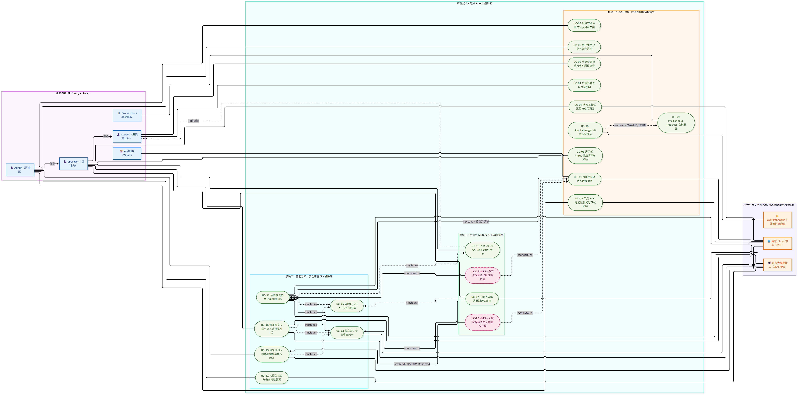
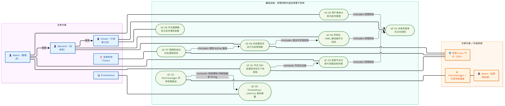
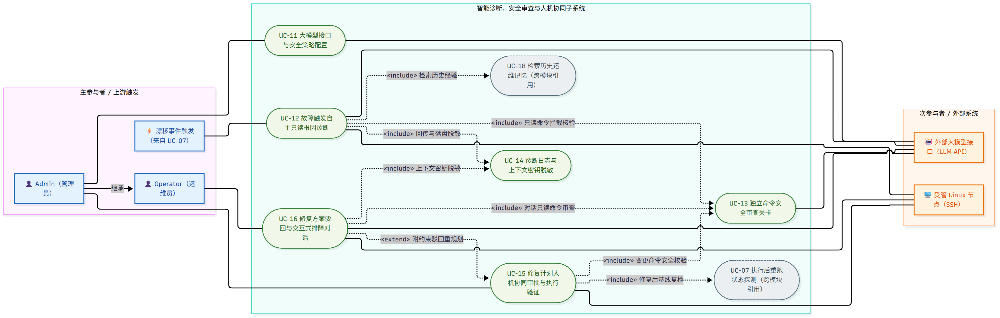
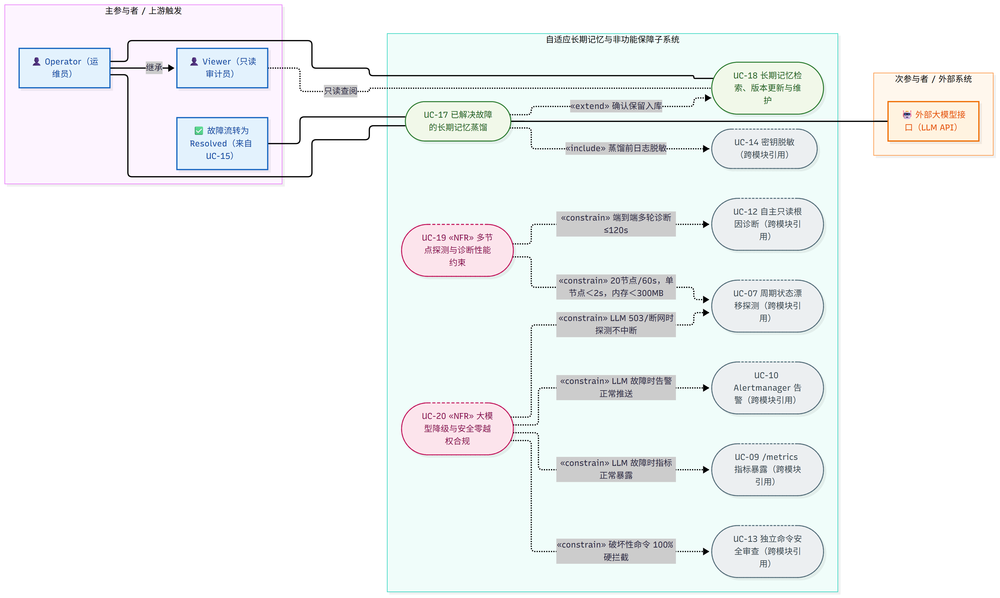

## 用例清单与用例图总览

### 1. 参与者说明

- **主参与者**：
    - `Viewer（只读审计员）`：基础角色，仅具备健康概览、漂移告警、诊断轨迹与记忆库的只读查看权限。
    - `Operator（运维员）`（继承 `Viewer`）：维护 YAML 声明式基线、试运行并激活调度、发起排障对话、驳回方案重规划、确认并维护长期记忆。
    - `Admin（管理员）`（继承 `Operator`）：管理用户与角色、纳管 Linux 节点与加密凭据、配置大模型与安全策略、审批执行变更修复计划、接收外部告警。
    - `系统时钟`：按基线周期触发定时只读状态漂移探测。
    - `Prometheus`：定时拉取 `/metrics` 指标端点并触发告警规则。
- **次参与者 / 外部系统**：
    - `受管 Linux 节点`：执行 SSH 连通测试、只读漂移探测、只读诊断命令及审批通过后的变更修复命令。
    - `外部大模型接口`：提供 ReAct 根因诊断推理、独立命令安全审查、交互式排障对话与记忆蒸馏能力。
    - `Alertmanager`：将告警推送至 Webhook / IM / 邮件并通知管理员。

### 2. 用例清单与用户故事关联

#### 2.1 模块一：基础设施、权限控制与监控告警

| 用例编号  | 关联需求                                                             | 用例名称                            | 主参与者                       | 次参与者 / 外部系统                | 简要说明                                                                     |
| :-------- | :------------------------------------------------------------------- | :---------------------------------- | :----------------------------- | :--------------------------------- | :--------------------------------------------------------------------------- |
| **UC-01** | [US-01](./user_stories.md#us-01-多角色登录与访问控制)                | 多角色登录与访问控制                | Viewer（Operator、Admin 继承） | —                                  | 校验三角色身份与接口权限，拦截越权请求（HTTP 403）并记录审计日志             |
| **UC-02** | [US-02](./user_stories.md#us-02-用户角色分配与账号管理)              | 用户角色分配与账号管理              | Admin                          | —                                  | 创建、停用成员账号并分配 Admin / Operator / Viewer 角色                      |
| **UC-03** | [US-03](./user_stories.md#us-03-受管-linux-节点注册与凭据加密存储)   | 受管 Linux 节点注册与凭据加密存储   | Admin                          | —                                  | 录入主机地址、端口、用户名与 SSH 私钥，经主密钥加密后存入 SQLite             |
| **UC-04** | [US-04](./user_stories.md#us-04-节点-ssh-连通性测试与下线移除)       | 节点 SSH 连通性测试与下线移除       | Admin                          | 受管 Linux 节点                    | 5 秒内完成 SSH 握手并返回主机信息或明确错误原因；支持移除下线节点            |
| **UC-05** | [US-05](./user_stories.md#us-05-声明式期望状态-yaml-基线编写与校验)  | 声明式期望状态 YAML 基线编写与校验  | Operator（Admin 继承）         | —                                  | 定义服务/容器/磁盘等期望状态与自然语言意图，保存前执行语法与字段校验         |
| **UC-06** | [US-06](./user_stories.md#us-06-状态基线试运行与启用调度)            | 状态基线试运行与启用调度            | Operator（Admin 继承）         | 受管 Linux 节点                    | 对草稿基线执行即时探测并比对差异，确认后置为 Active 并加入定时调度           |
| **UC-07** | [US-07](./user_stories.md#us-07-周期性自动状态漂移探测)              | 周期性自动状态漂移探测              | 系统时钟                       | 受管 Linux 节点                    | 按周期对 Active 基线节点执行轻量级只读 SSH 探测，发现漂移生成 Open 故障事件  |
| **UC-08** | [US-08](./user_stories.md#us-08-节点健康概览与实时漂移状态查看)      | 节点健康概览与实时漂移状态查看      | Viewer（Operator、Admin 继承） | —                                  | 展示受管节点总数、健康状态与漂移事件列表，对 Viewer 隐藏或禁用写操作         |
| **UC-09** | [US-09](./user_stories.md#us-09-prometheus-metrics-指标接口暴露)     | Prometheus /metrics 指标接口暴露    | Prometheus                     | —                                  | 暴露符合 OpenMetrics/Prometheus 格式的节点健康、探测耗时、漂移及模型调用指标 |
| **UC-10** | [US-10](./user_stories.md#us-10-alertmanager-异常告警与外部消息推送) | Alertmanager 异常告警与外部消息推送 | Prometheus                     | Alertmanager / 外部消息通道、Admin | 持续漂移或待审批事件触发 Firing 后，1 分钟内推送至外部消息渠道               |

#### 2.2 模块二：智能诊断、安全审查与人机协同

| 用例编号  | 关联需求                                                        | 用例名称                       | 主参与者                           | 次参与者 / 外部系统             | 简要说明                                                                                           |
| :-------- | :-------------------------------------------------------------- | :----------------------------- | :--------------------------------- | :------------------------------ | :------------------------------------------------------------------------------------------------- |
| **UC-11** | [US-11](./user_stories.md#us-11-大模型接口与自主性安全策略配置) | 大模型接口与自主性安全策略配置 | Admin                              | 外部大模型接口                  | 配置兼容 OpenAI 的模型端点、加密 API Key、最大推理轮数 max_turns 与脱敏规则                        |
| **UC-12** | [US-12](./user_stories.md#us-12-故障触发自主只读根因诊断)       | 故障触发自主只读根因诊断       | 漂移事件触发（源自 UC-07）         | 外部大模型接口、受管 Linux 节点 | 检索历史记忆并执行只读 ReAct 多轮推理，产出根因报告与修复计划并流转至 Pending Approval / Escalated |
| **UC-13** | [US-13](./user_stories.md#us-13-独立命令安全审查关卡)           | 独立命令安全审查关卡           | —（被 UC-12 / UC-15 / UC-16 包含） | 外部大模型接口                  | 执行 SSH 命令前由独立命令审查智能体将其分类为只读、变更或破坏性指令，硬拦截诊断阶段任何非只读命令（异常时 Fail-Closed） |
| **UC-14** | [US-14](./user_stories.md#us-14-诊断日志与回传上下文密钥脱敏)   | 诊断日志与回传上下文密钥脱敏   | —（被 UC-12 / UC-16 / UC-17 包含） | —                               | 在 SSH 输出发往外部大模型或落盘前自动掩码 API Key、Token 与密码为 [REDACTED_SECRET]                |
| **UC-15** | [US-15](./user_stories.md#us-15-修复计划人机协同审批与执行验证) | 修复计划人机协同审批与执行验证 | Admin                              | 受管 Linux 节点                 | 审阅诊断证据与变更命令并批准执行，执行后自动复检状态基线，通过后置为 Resolved                      |
| **UC-16** | [US-16](./user_stories.md#us-16-修复方案驳回与交互式排障对话)   | 修复方案驳回与交互式排障对话   | Operator（Admin 继承）             | 外部大模型接口、受管 Linux 节点 | 通过自然语言追问节点异常，或附带约束条件驳回方案触发智能体重新规划                                 |

#### 2.3 模块三：自适应长期记忆与非功能需求约束

| 用例编号  | 关联需求                                                                | 用例名称                                 | 主参与者                                | 次参与者 / 外部系统 | 简要说明                                                                                         |
| :-------- | :---------------------------------------------------------------------- | :--------------------------------------- | :-------------------------------------- | :------------------ | :----------------------------------------------------------------------------------------------- |
| **UC-17** | [US-17](./user_stories.md#us-17-已解决故障的自适应长期记忆蒸馏)         | 已解决故障的自适应长期记忆蒸馏           | Operator、故障解决事件（源自 UC-15）    | 外部大模型接口      | 故障 Resolved 后将脱敏排障过程与有效修复步骤压缩为结构化记忆卡片，由 Operator 确认入库或丢弃     |
| **UC-18** | [US-18](./user_stories.md#us-18-长期记忆检索版本更新与日常维护)         | 长期记忆检索、版本更新与日常维护         | Operator（维护）、Viewer（只读）        | —                   | 支持关键词检索、命中计数 hit_count 递增、方案演进时写入新版本并将旧版标为 Superseded             |
| **UC-19** | [US-19](./user_stories.md#us-19-nfr-多节点周期探测与诊断响应性能约束)   | [NFR] 多节点周期探测与诊断响应性能约束   | —（约束 UC-07、UC-12）                  | —                   | 4 vCPU 下 20 节点/60s 压测：内存 ＜ 300 MB、空闲 CPU ＜ 10%、单节点探测 ＜ 2s、端到端诊断 ≤ 120s |
| **UC-20** | [US-20](./user_stories.md#us-20-nfr-大模型接口故障降级与安全零越权合规) | [NFR] 大模型接口故障降级与安全零越权合规 | —（约束 UC-07 / UC-09 / UC-10 / UC-13） | —                   | LLM 不可用时基础探测、指标与告警降级可用；破坏性命令拦截率 100%，未授权高危变更零执行            |

---

### 3. 用例图

#### 3.1 系统总览（UC-01 ~ UC-20）

[uc_overview.md](./use_case_assets/uc_overview.md)

#### 3.2 模块一：基础设施、权限控制与监控告警（UC-01 ~ UC-10）

[uc_mod1_infra_monitoring.md](./use_case_assets/uc_mod1_infra_monitoring.md)

#### 3.3 模块二：智能诊断、安全审查与人机协同（UC-11 ~ UC-16）

[uc_mod2_diagnosis_security.md](./use_case_assets/uc_mod2_diagnosis_security.md)

#### 3.4 模块三：自适应长期记忆与非功能需求约束（UC-17 ~ UC-20）

[uc_mod3_memory_nfr.md](./use_case_assets/uc_mod3_memory_nfr.md)

